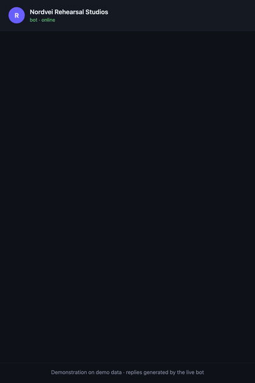
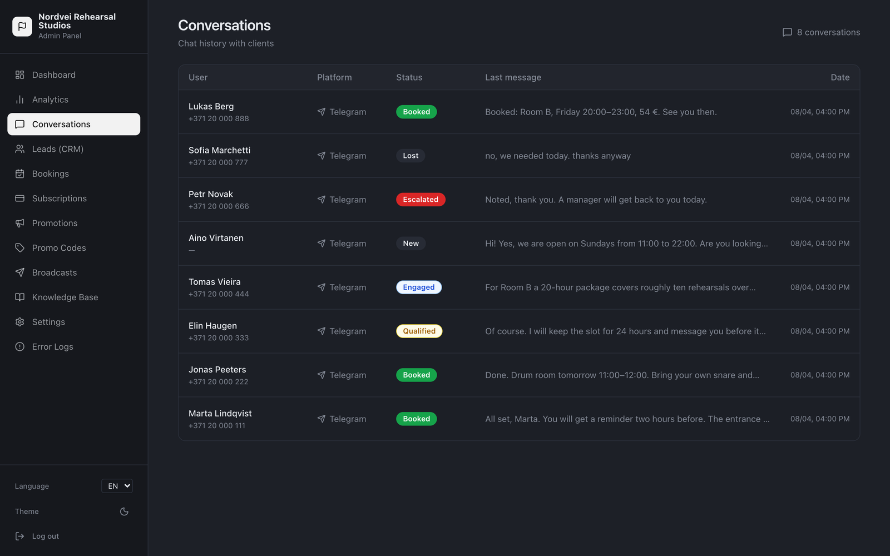
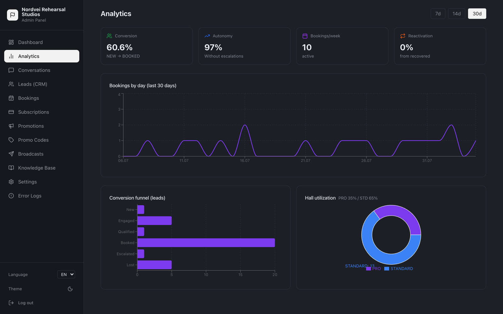
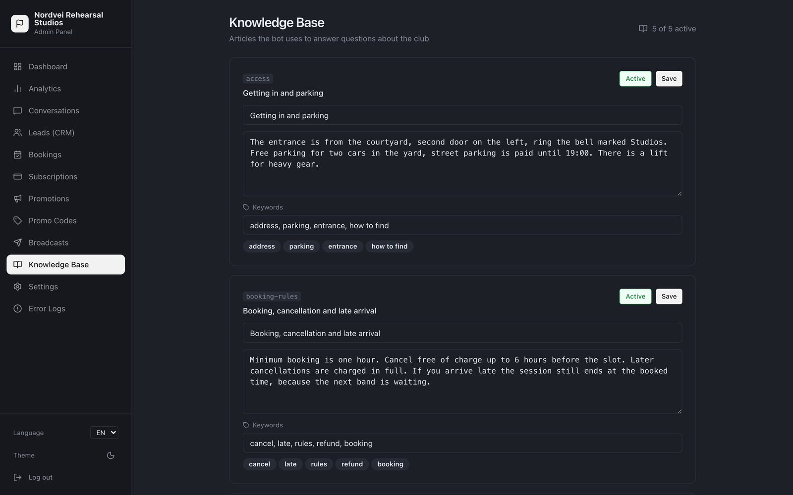

# Rivella

Multi-tenant SaaS for service businesses. A client writes to the business's Telegram bot, and an assistant on the Claude API answers questions, checks free slots and books the visit. It runs in production for several businesses, including a sim-racing club.

**Live:** [rivella.app](https://rivella.app) (admin panel)

  

Screenshots show a demo business with sample data. The chat replies come from the live bot.

## What the assistant does

- Answers questions from the business's knowledge base, using PostgreSQL full-text search.
- Checks real-time availability and creates bookings through the YClients API.
- Collects the client's name and phone and qualifies the lead.
- Sends a reminder before the visit and a follow-up after it.
- Hands the conversation to a human manager when it can't help.

Each business gets its own bot, its own booking account and its own settings (system prompt, knowledge base, pricing). They all share one deployment. A new business is added from the superadmin panel without a redeploy.

## Admin panel

Conversations with clients and their booking status:

Conversion, bookings per day and room utilization:

The knowledge base the assistant answers from:

## How it's built

- The assistant runs a bounded tool-calling loop over 15 tools (availability, booking, rescheduling, promo codes, knowledge search, hand-off to a manager and more), and a validator checks every reply before it goes out.
- Five scheduled jobs: reminders, post-visit follow-up, no-show detection, abandoned-booking recovery and a daily digest.
- Multi-tenancy is row-level: every record is scoped by `tenantId`.
- Architecture decisions are written down as ADRs.

## Stack

| Layer | Tech |
|---|---|
| API | NestJS, Prisma, PostgreSQL, grammY, Anthropic SDK |
| Admin | Next.js (App Router), React, Tailwind CSS, Radix UI |
| Repo | pnpm workspaces, shared TypeScript types package |
| Delivery | Docker, GitHub Actions, VPS |

## Testing and delivery

- 138 API tests in Jest.
- OpenAPI spec generated from the code.
- GitHub Actions runs the tests, builds Docker images and deploys them to the VPS.

I built and deployed it solo.

The source is private. I'm happy to walk through the code on a call: chumak.aleksandr96@gmail.com
